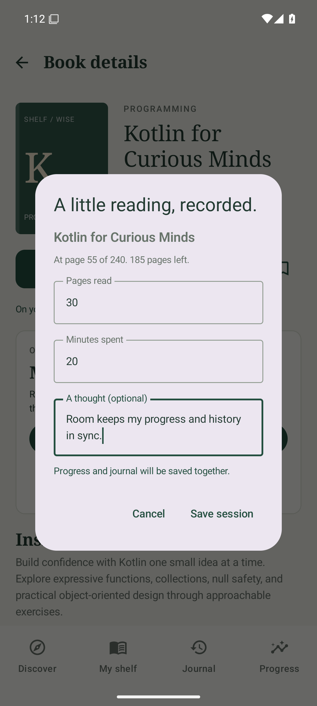
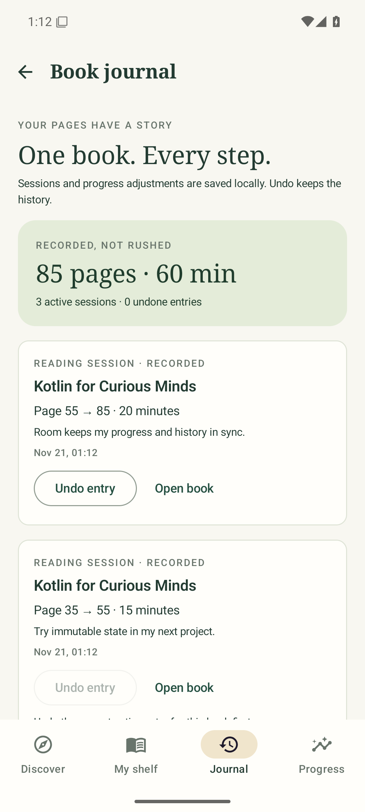
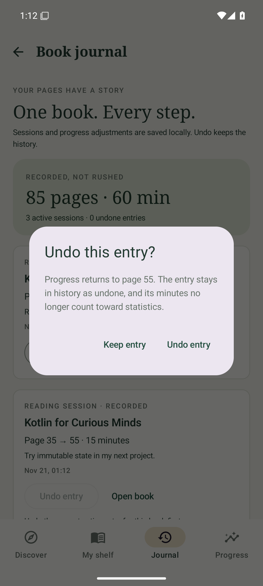
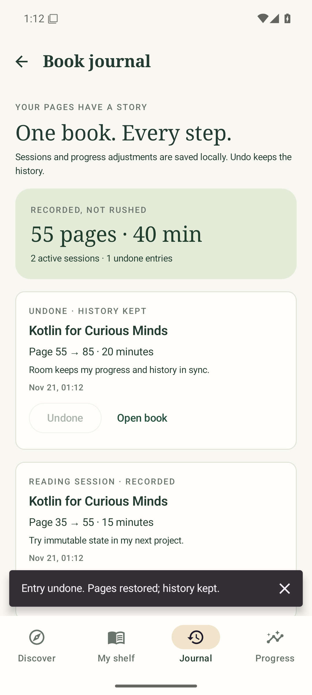
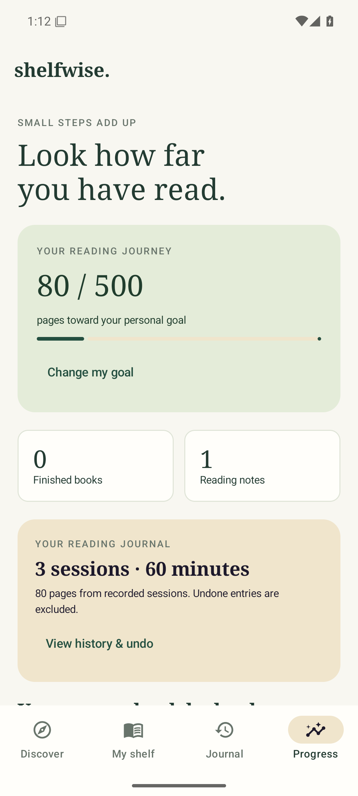

# Shelfwise — Task 3: MVVM and local data storage

An Android continuation of the previous **Shelfwise** homework. Author: Dias Kasymzhan.
**Kotlin · Jetpack Compose · Material 3 · Navigation Compose · ViewModel · StateFlow · Room**

Submit this branch: **[task-3-mvvm-room](https://github.com/dikos1705/mob_dev/tree/task-3-mvvm-room)**.
The [midterm-android](https://github.com/dikos1705/mob_dev/tree/midterm-android) branch preserves the previous Android version; `main` preserves the Kotlin console assignment.

## What changed

- **Room is the source of truth:** the editable catalog, saved books, loans, notes, progress, goal and reading journal are persisted in a local SQLite database.
- **Complete book CRUD in the UI:** add a book from Discover, open its details, edit all its fields, or delete it after an explicit confirmation.
- **Additional feature — reading journal with transactional progress and undo:** record pages, minutes and a thought; review chronological history; undo the latest active entry for a book; see progress and session statistics update across screens.
- **Existing features remain:** search/subject filters, bookmarks, Reading/Saved/Finished shelf, three-loan limit, different print/digital loan periods, returns, slider and ten-page progress controls, notes and personal goals.
- **One-time import:** committed records and the goal from the previous SharedPreferences version are imported when the Room database is first initialized.

All catalog examples are fictional. The app is offline and needs no accounts, permissions, server or API keys. Borrowing is a personal local simulation.

## Screenshots of the additional feature

These are **actual screenshots of this version running on a Pixel 6 emulator, Android 15 / API 35**. The screenshot test prepares fictional reading history through the production repository and then uses the real UI to record and undo a session. A normal fresh install starts with eight seed books and no reading history.

| 1. Record pages and time | 2. Review the journal | 3. Confirm an undo |
| --- | --- | --- |
|  |  |  |

| 4. History retained after undo | 5. Statistics updated across screens |
| --- | --- |
|  |  |

The book-filtered journal and the global dashboard intentionally have different totals: the journal shows one book, while Progress includes all books. Undone entries do not contribute to session statistics.

## Run

1. Clone the task branch into a short Latin-only path:

   ```sh
   git clone --branch task-3-mvvm-room https://github.com/dikos1705/mob_dev.git Shelfwise
   cd Shelfwise
   ```

2. Open the root folder in Android Studio supporting **Android Gradle Plugin 8.9.2**. Select **JDK 17 or 21** as the Gradle JDK.
3. Install **SDK Platform 35** and **Build Tools 35.0.0**. Android Studio creates the ignored `local.properties` with your SDK path.
4. Sync Gradle, select the `app` configuration and run on **Android 8.0 / API 26 or newer**.

The included Wrapper uses Gradle 8.14.3. No separate Gradle installation is needed. Internet is needed for initial build dependencies, not for using the app.

Terminal build (Windows):

```powershell
.\gradlew.bat :app:assembleDebug :app:testDebugUnitTest :app:lintDebug
```

macOS/Linux:

```sh
chmod +x gradlew
./gradlew :app:assembleDebug :app:testDebugUnitTest :app:lintDebug
```

Set `JAVA_HOME` and `ANDROID_HOME` when building outside Android Studio. Debug APK: `app/build/outputs/apk/debug/app-debug.apk`. Install with `adb install -r app/build/outputs/apk/debug/app-debug.apk`. GitHub Actions also publishes a debug APK artifact.

## Try the complete workflow

1. **Discover → +:** add a title, author, subject, page count, format and description. Missing fields or invalid page counts show inline validation.
2. **Book details → Edit book:** modify and save the book. Stable IDs keep its saved state, progress and history attached to the same record.
3. **Borrow book → Record a reading session:** enter pages, 1–240 minutes and an optional note. Pages cannot exceed the remaining pages; a book must be on loan.
4. **Book journal / Journal tab:** review saved entries. Older entries are protected while newer active entries exist for that book.
5. **Undo entry → confirmation:** restore the previous page count. The entry is marked undone rather than erased. The action is atomic and cannot be applied twice.
6. **Progress:** view updated page goals, completed books, notes, active session count, minutes and pages. Manual slider/ten-page changes also appear as undoable progress adjustments, without inventing reading time.
7. **Book details → Delete book:** cancel to keep it, or confirm permanent deletion. The associated record and journal are removed through foreign-key cascades; other books and the goal remain.
8. Close and reopen the app. Saved books, edits, loans, notes, goals, progress and journal states remain. Deleting every book leaves a genuine empty collection; initialization does not recreate deleted seed books.

Editing a book cannot reduce its total pages below its saved progress or historical page positions. Return an active loan before changing its print/digital format, so the existing due-date policy does not change unexpectedly.

## MVVM and data flow

```text
Compose screens → ViewModel action → Repository → Room DAO → SQLite
       ↑              ↑                            |
       └── StateFlow ──┴──── transactional Room Flow ┘
```

| Layer | Responsibility |
| --- | --- |
| `ui/*Screen.kt`, `SessionEditor.kt`, `Components.kt` | Render immutable state; own saveable form/search drafts; emit callbacks |
| `LibraryViewModel.kt` | Expose read-only `StateFlow<LibraryUiState>`; collect repository updates; serialize actions; handle errors and navigation results |
| `data/LibraryRepository.kt` | Repository interface and Room implementation; validation, CRUD, transaction boundaries, import, session/undo rules |
| `data/LibraryDatabase.kt` | Four Room entities, DAO, relations, transactional snapshot Flow, database definition |
| `domain/Models.kt`, `domain/Journal.kt` | Immutable models, previous loan/progress rules and new form/session validation |
| `ShelfwiseApplication.kt` | One application-scoped Room database and repository |
| `data/LibraryStore.kt` | Read-only legacy preference reader; not used for new writes |
| `data/Catalog.kt` | Initial fictional seed catalog only; screens never use it as live storage |

The app root uses **`collectAsStateWithLifecycle()`**. `LibraryDao.observeLibrary()` returns a Room **Flow** of a transactional relational snapshot, including catalog, reading records, settings and journal. Data changes invalidate that query automatically; the ViewModel publishes the new snapshot to all screens without manual reloads. Detail navigation passes only stable IDs, so it resolves current database-backed data rather than a stale copied book.

The ViewModel uses `viewModelScope` and a `Mutex` for action handling. Room `withTransaction` protects compound operations, including the three-loan rule, session-plus-progress writes and undo-plus-progress restoration. Room dispatches suspend DAO work off the main thread. Legacy preference reading runs on `Dispatchers.IO`. Composables do not access DAOs/preferences or directly mutate application data.

## Room schema and persistence

- **BookEntity:** UUID/seed ID, editable book metadata, stable catalog position.
- **ReadingRecordEntity:** book foreign key, saved flag, loan timestamp, page progress and note.
- **ReadingSessionEntity:** generated ID, book foreign key, before/after page positions, minutes, note, timestamp and nullable undo timestamp.
- **SettingsEntity:** single-row page goal and initialization marker.

Book deletion cascades to its reading record and sessions. The first Room schema is exported under `app/schemas/`; no destructive migration fallback is enabled. The previous app used preferences rather than Room, so this upgrade performs a one-time preference-to-database import in a transaction. Initialization is marked complete only after a successful commit; legacy data is not deleted. Future Room schema versions would require explicit migrations.

The database survives process/activity recreation and app/device restarts. Uninstalling the app or clearing app storage removes local data. Unsaved form drafts use `rememberSaveable` for configuration recreation; save actions are required to persist edits to Room.

## Assignment coverage

| Requirement | Implementation |
| --- | --- |
| Custom-object collection with stable keys | Discover/Shelf book `LazyColumn`, Journal session `LazyColumn`, stable book/session IDs |
| List and detail navigation | Navigation Compose: Discover, Shelf, Progress, Journal, Book details, New/Edit book, per-book journal |
| Create/edit with validation | `BookEditorScreen`, `BookDraft.errors()`, repository validation |
| Delete confirmation | Book details `AlertDialog`, explicit permanent-delete action |
| Advanced integrated feature | Session form → transaction → journal → conditional confirmed undo → statistics |
| Empty states and feedback | Empty catalog/search/shelf/journal, loading/retry, validation text and dismissible snackbars |
| ViewModel + StateFlow + lifecycle collection | `LibraryViewModel`, `ShelfwiseApp` |
| Separate UI/VM/repository/data source | Layers described above |
| Room Entity/DAO, full CRUD and repository | Four entities, `LibraryDao`, `RoomLibraryRepository`; all connected to UI |
| Room Flow updates all screens | Transactional relational snapshot observed by the ViewModel |
| Durable data and consistency | Room transactions, stable navigation IDs, saveable drafts, close/reopen and UI tests |
| Previous features | Borrow/return/search/bookmarks/notes/progress/goals retained and regression tested |
| At least 3 screenshots in README | Five real captures of the additional feature above |

## Verification and screenshot reproduction

Local results: **13 JVM tests passed; 12 Android instrumentation tests passed** (5 Room/repository tests and 7 UI/screenshot tests). APK builds and Android lint completed. See [docs/VERIFICATION.md](docs/VERIFICATION.md) for details and limits, and [DEFENSE_RU.md](DEFENSE_RU.md) for a Russian explanation.

Run instrumentation on a **test emulator**, because these tests reset only this app's local database and legacy preferences:

```sh
./gradlew :app:connectedDebugAndroidTest
```

To keep screenshots accessible after the test runner finishes, install the APKs and run directly:

```sh
./gradlew :app:installDebug :app:installDebugAndroidTest
adb shell am instrument -w -e class 'com.dias.shelfwise.RoomRepositoryTest,com.dias.shelfwise.ShelfwiseAppTest' com.dias.shelfwise.test/androidx.test.runner.AndroidJUnitRunner
adb pull /sdcard/Android/data/com.dias.shelfwise/files/task3-screenshots docs/
```

On Windows use `gradlew.bat`. The screenshot test is `ShelfwiseAppTest.z_captureTask3Screenshots`. The CI workflow runs the same checks and publishes reports, screenshots and an APK.

Submit the **task branch link** above in the course system and press **Turn In**. Source upload does not press that button for you.

References: [Room](https://developer.android.com/training/data-storage/room), [Compose state](https://developer.android.com/develop/ui/compose/state), [lifecycle-aware collection](https://developer.android.com/develop/ui/compose/state#other-supported-types-of-state), [Navigation Compose](https://developer.android.com/develop/ui/compose/navigation).
