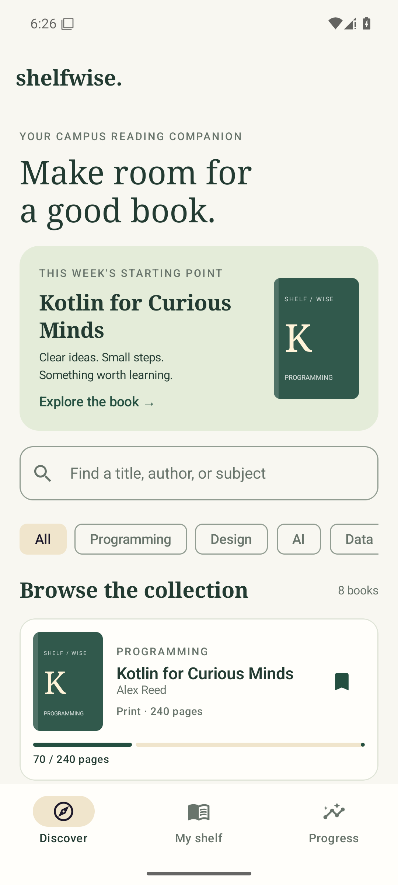
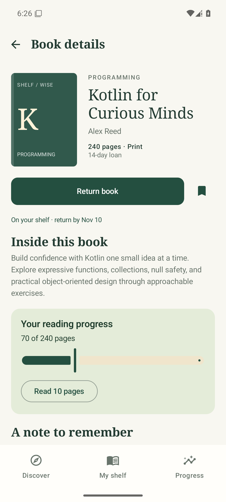
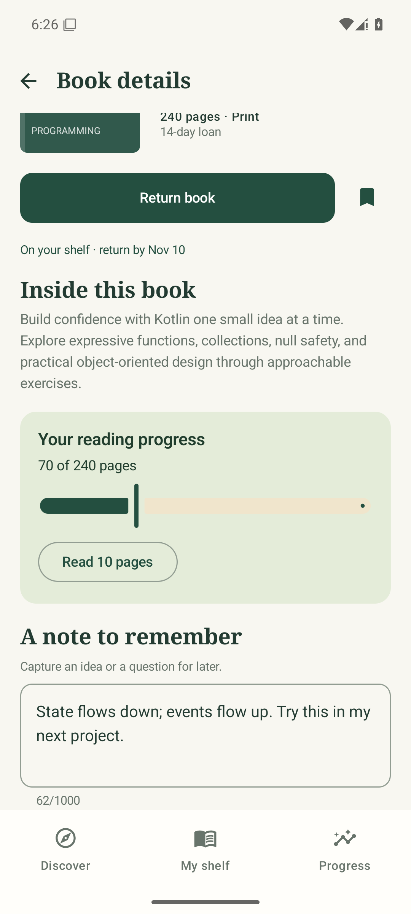
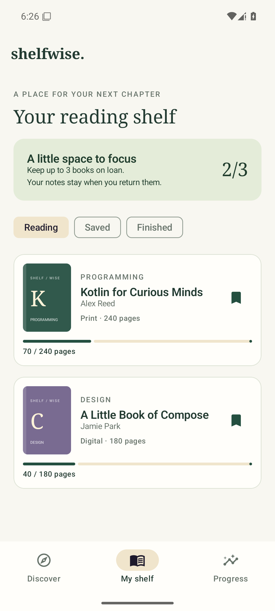
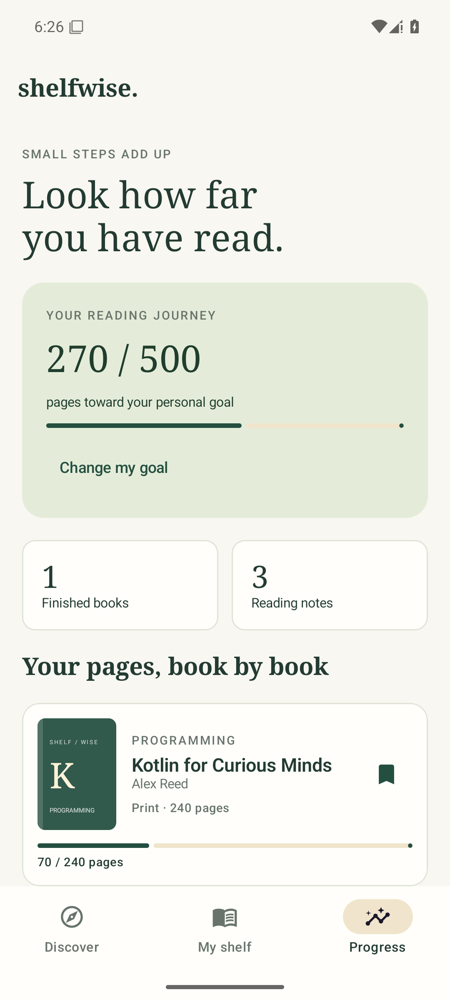

# Shelfwise

**A quiet place to discover books and build a reading habit.**

Android midterm project for Mobile Programming. Author: Dias.
Built with **Kotlin, Jetpack Compose, Material 3, Navigation Compose, ViewModel and StateFlow**.
An Android continuation of the first Kotlin library assignment, redesigned around a complete mobile reading workflow.

> Open the **[midterm-android branch](https://github.com/dikos1705/mob_dev/tree/midterm-android)** for this project. The `main` branch preserves the original Kotlin console homework.

## What the app does

1. **Discover:** search eight fictional books by title, author or subject; combine search with category filters; bookmark books for later.
2. **My shelf:** view Reading, Saved and Finished collections. Borrow up to three books and return them when ready. Print and digital books have different loan periods.
3. **Book details:** see a description and due date, record pages with a slider or a ten-page increment, and save a personal reading note.
4. **Progress:** see cumulative pages, completed books and note count; set a personal goal between 50 and 5000 pages.

These features form one workflow: discover a book, borrow it, read and take notes, then review progress. Returning a book frees a loan slot while preserving reading history. Completed books are in the Finished filter, including completed books still on loan.

This is an **offline personal library simulation**. All catalog titles, authors and descriptions are fictional. Borrowing is local state; the app does not reserve a real library copy, deliver an e-book or connect to a server. There are no accounts, ads, permissions or network requests.

## Screenshots

Actual captures of the running application on a Pixel 6 emulator, Android 15 / API 35. The screenshot test seeds fictional reading history; a fresh installation starts with an empty shelf.

| Discover and search | Book details |
| --- | --- |
|  |  |

| Reading progress and notes | My shelf | Personal goal |
| --- | --- | --- |
|  |  |  |

## Run in Android Studio

1. Clone the Android branch into a short path, for example:

   ```bash
   git clone --branch midterm-android https://github.com/dikos1705/mob_dev.git Shelfwise
   ```

2. Open the **Shelfwise root folder**, containing `settings.gradle.kts`, in Android Studio with support for Android Gradle Plugin 8.9.2 (Meerkat or newer).
3. Use the bundled Gradle Wrapper and **JDK 17 or 21** as the Gradle JDK. Install **Android SDK Platform 35** and Build Tools **35.0.0** through SDK Manager. Let Gradle sync finish; the first sync needs internet.
4. Select the `app` run configuration and an emulator or device running **Android 8.0 / API 26 or newer**, then press Run.

Android Studio creates `local.properties` with your SDK location. This machine-specific file is intentionally ignored by Git. No API keys, `.env` files or additional services are required. On Windows, prefer a Latin-only project path, such as `C:\AndroidProjects\Shelfwise`.

### Build from a terminal

Set `JAVA_HOME` to a full JDK and `ANDROID_HOME` to your Android SDK, or create an ignored `local.properties` file containing `sdk.dir=/path/to/sdk`.

Windows PowerShell:

```powershell
.\gradlew.bat :app:assembleDebug :app:testDebugUnitTest :app:lintDebug
# Start an emulator first:
.\gradlew.bat :app:connectedDebugAndroidTest
```

macOS / Linux:

```bash
chmod +x gradlew
./gradlew :app:assembleDebug :app:testDebugUnitTest :app:lintDebug
./gradlew :app:connectedDebugAndroidTest
```

APK output: `app/build/outputs/apk/debug/app-debug.apk`.
Install it with `adb install -r app/build/outputs/apk/debug/app-debug.apk`.
The instrumentation suite clears this app's data before each test and leaves demo history after its screenshot test. Use a test emulator, not a device with reading history you want to keep.

## Architecture and state

```text
app/src/main/java/com/dias/shelfwise/
  MainActivity.kt                  Activity entry point and ViewModel factory
  LibraryViewModel.kt              StateFlow, serialized actions, coroutine/error handling
  domain/Models.kt                 Immutable models and pure LibraryActions rules
  data/Catalog.kt                  Fictional local book catalog
  data/LibraryStore.kt             Store interface and JSON SharedPreferences persistence
  ui/ShelfwiseApp.kt               Navigation graph, tabs, lifecycle-aware state collection
  ui/*Screen.kt                   Four screens and hoisted event callbacks
  ui/Components.kt                Shared book cover, card, bookmark and empty-state components
  ui/Theme.kt                     Material 3 light/dark colors and typography
```

**Data flows down; events flow up.** The app root collects `viewModel.state` with `collectAsStateWithLifecycle()`. Screens receive immutable data and callbacks. They do not access preferences or mutate the catalog. Domain actions validate a change, the ViewModel persists it and then publishes a new state. A `Mutex` prevents simultaneous read-modify-write actions from losing updates. Disk writes use `withContext(Dispatchers.IO)`; failures keep the old state and display a retry message.

| Requirement | Where it is demonstrated |
| --- | --- |
| 3+ functional screens and navigation | Discover, My shelf, Progress and `book/{bookId}` in `ShelfwiseApp.kt`; bottom tabs and detail back navigation |
| 3+ meaningful features | Combined search/filter, bookmarks, loans/returns, progress/notes, personal goals |
| Material 3 and reusable composables | `Theme.kt`, `BookCard`, `BookCover`, `SaveBookButton`, `EmptyState`, `GoalEditor` |
| `remember` | Derived search results, snackbar host, tab definitions and navigation controller |
| `rememberSaveable` | Search/category, shelf filter, unsaved note, slider draft, goal dialog visibility and input |
| State hoisting | Screens accept data/events; `GoalEditor` receives value and change/save callbacks |
| ViewModel / StateFlow | `LibraryViewModel` exposes read-only `StateFlow<LibraryUiState>`; root uses lifecycle-aware collection |
| Classes, collections, functions | `Book`, `ReadingRecord`, `UserLibrary`, `LibraryStore`; `filter`, `mapNotNull`, `sumOf`, `count`, maps and pure domain functions |
| Coroutines | `viewModelScope.launch`, `Mutex.withLock`, suspending store, IO dispatcher, `LaunchedEffect` snackbar |
| Configuration changes | Activity-scoped ViewModel retains library state; `rememberSaveable` restores UI drafts; Navigation Compose restores navigation state |
| Relaunch persistence | Committed JSON in private SharedPreferences restores loans, bookmarks, pages, notes and goal; no uninstall/clear-data persistence is claimed |

SharedPreferences is sufficient for eight records and one goal; a production catalog would use a database/repository and server-side loan validation. The app has no deadline notifications or synchronization. Unsaved UI drafts survive configuration recreation but are not a replacement for tapping Save note. Reset all local data through Android Settings → Apps → Shelfwise → Storage → Clear storage.

## Validation and defense

See [verification results](docs/VERIFICATION.md) for the exact checked build/device and results. Automated checks cover domain boundaries, concurrent actions, save failures, UI workflow, configuration recreation, relaunch persistence and malformed local storage. `ShelfwiseAppTest.z_captureReadmeScreenshots` produces the images above from the actual emulator display.

For a short Russian demonstration script and technical questions, see [DEFENSE_RU.md](DEFENSE_RU.md).

### Screenshot reproduction

The connected-test runner may uninstall the app during cleanup. To keep screenshots available for export, install both APKs and run the capture test directly (replace `gradlew` with `gradlew.bat` on Windows):

```bash
./gradlew :app:installDebug :app:installDebugAndroidTest
adb shell am instrument -w -e class 'com.dias.shelfwise.ShelfwiseAppTest#z_captureReadmeScreenshots' com.dias.shelfwise.test/androidx.test.runner.AndroidJUnitRunner
adb pull /sdcard/Android/data/com.dias.shelfwise/files/screenshots docs/
```

The GitHub Actions workflow also assembles the APK, runs JVM tests and lint, and publishes a debug APK artifact. Emulator UI tests are verified locally; they are not part of that workflow.

## References

- [Compose state and state hoisting](https://developer.android.com/develop/ui/compose/state)
- [Navigation with Compose](https://developer.android.com/develop/ui/compose/navigation)
- [ViewModel overview](https://developer.android.com/topic/libraries/architecture/viewmodel)
- [Testing Compose](https://developer.android.com/develop/ui/compose/testing)

The interface, fictional catalog and book-cover graphics are contained in the source; no external images or copyrighted book covers are bundled.
